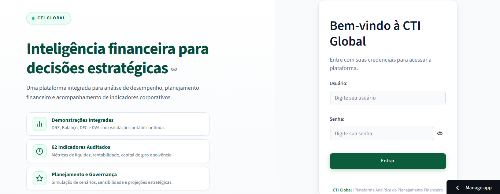

# FECAP - Fundação Escola de Comércio Álvares Penteado
<p align="center">
  <a href="https://www.fecap.br/">
    
  </a>
</p>

# ContaTech | Plataforma Analítica de Planejamento Financeiro
### Projeto Interdisciplinar (PI) — 4º Semestre | Ciência da Computação (2026)
**Parceira Corporativa:** CTI Global  
**ODS Vinculados:** ODS 8 (*Trabalho Decente e Crescimento Econômico*) e ODS 9 (*Indústria, Inovação e Infraestrutura*)

---

## 🌐 Acesso Rápido à Aplicação

- **Deploy em Nuvem:** [https://dashboard-contatech.streamlit.app](https://dashboard-contatech.streamlit.app)
- **Credenciais de Auditoria e Acesso:**
  - **Usuário:** `admin`
  - **Senha:** `admin123`

---

## 👥 Equipe do Projeto

| Integrante | RA | LinkedIn |
| :--- | :---: | :---: |
| **Rafael Chagas Silva** | 25027262 | [](https://www.linkedin.com/in/rafaelchagas06/) |
| **Guilherme Leão Rodrigues** | 25027205 | [](https://www.linkedin.com/in/guilherme-le%C3%A3o-277053347) |
| **Izabelli Ribeiro dos Santos** | 25027357 | [](https://www.linkedin.com/in/izabelliribeiro/) |
| **Breno Sales Colaneri** | 24026968 | [](https://www.linkedin.com/in/breno-sales-colaneri-231b59322/) |

### 👨‍🏫 Professores Orientadores
- Prof. Dr. **Eduardo Savino Gomes**
- Prof. Me. **Luis Fernando dos Santos Pires**
- Prof. Me. **Rodnil da Silva Moreira Lisboa**
- Prof. Me. **Mauricio Lopes da Cunha**
- Prof. Me. **Adriano Felix Valente**

---

## 📖 Descrição Geral

A **ContaTech** é uma plataforma corporativa analítica e preditiva desenvolvida para estruturar, auditar e projetar a saúde financeira da **CTI Global**. O sistema unifica quatro unidades curriculares fundamentais da Ciência da Computação:

1. **Ciência de Dados:** Arquitetura de dados em 3 camadas, dashboard executivo interativo em Streamlit com 17 visões analíticas, modelos preditivos OLS com prevenção de vazamento de dados (*data leakage*) e 43 testes automatizados.
2. **Contabilidade e Finanças:** Demonstrações financeiras completas (DRE com EBITDA segregado, Balanço Patrimonial com verificação de igualdade patrimonial contínua, DFC e DVA), catálogo com **62 KPIs auditados**, simulador de sensibilidade financeira com choques paramétricos em tempo real e modelagem de *Unit Economics* (CAC, LTV, LTV/CAC, Payback).
3. **Análise Inferencial de Dados:** Estatística descritiva e diagnóstica rigorosa (médias, dispersão, assimetria, curtose, Tukey para outliers), matrizes de correlação paramétrica (Pearson) e não paramétrica (Spearman), além de modelagem de regressão linear simples e diagnósticos econométricos de resíduos (Jarque-Bera, Breusch-Pagan / White HC3, VIF).
4. **Engenharia de Software e Arquitetura de Sistemas:** Aplicação de métodos ágeis (Scrum/Kanban), documentação formal de requisitos de software (funcionais e não-funcionais) e modelagem arquitetural completa em UML (Componentes, Casos de Uso, Classes, Sequência e Atividades).

---

## 🖼️ Visão da Interface (Dashboard Streamlit)

<p align="center">
  
  
</p>
<p align="center">
  
  
</p>


## 📊 Matriz de Entregas por Disciplina

### 🔹 Entrega 1 (Fundamentação, Exploração e Requisitos)
- **Ciência de Dados:** Tratamento e limpeza do dataset oficial (`Demonstrativo Fecap v3.csv`), transformações de formato (long/wide), consolidação no Google Colab, análise exploratória e estatísticas descritivas preliminares.
- **Contabilidade e Finanças:** Estruturação da planilha contábil multianual com 1.200 cenários, elaboração dos primeiros demonstrativos (DRE, BP, DFC) e parametrização dos KPIs fundamentais.
- **Análise Inferencial de Dados:** Análise descritiva univariada, tratamento de anomalias numéricas no padrão monetário brasileiro, identificação de outliers por boxplots e distribuições por histogramas.
- **Engenharia de Software:** Documento de engenharia de requisitos de software, matriz de rastreabilidade e aplicação de práticas ágeis.

### 🔹 Entrega 2 (Solução Final Funcional, Modelagem Avançada e UML)
- **Ciência de Dados:** Dashboard web completo e responsivo publicado no Streamlit Cloud com 17 páginas, modelagem econométrica OLS com partição `GroupShuffleSplit` (prevenção contra *data leakage*) e filtro detector de tautologia contábil, e suíte com **43 testes automatizados**.
- **Contabilidade e Finanças:** Painel Financeiro Operacional contendo:
  - DRE completa com segregação de EBITDA;
  - Balanço Patrimonial validado continuamente ($\text{Ativo} = \text{Passivo} + \text{PL}$);
  - Demonstração dos Fluxos de Caixa (DFC) reconciliada com a DRE;
  - Índices avançados da DFC (Qualidade do Caixa, Cobertura de Capex e Dívida);
  - Demonstração do Valor Adicionado (DVA);
  - Gestão de Capital de Giro e Prazos Médios (CCL, NCG, Saldo de Tesouraria, PMR, PMP e Ciclo Financeiro);
  - Simulador de Análise de Sensibilidade em memória (choques paramétricos de preço, desconto, custos, volume e WACC) e Unit Economics.
- **Análise Inferencial de Dados:** Modelagem inferencial de regressão linear simples e múltipla com diagnósticos de qualidade ($R^2$, MSE, estatística F e t), testes de resíduos e análise de limitações teóricas.
- **Engenharia de Software e Arquitetura de Sistemas:** Especificação arquitetural formal com diagramas UML completos (Componentes, Casos de Uso, Classes, Sequência e Atividades).

---

## 📈 Catálogo de Indicadores: 62 KPIs Auditados

A plataforma supera o requisito mínimo de cinco indicadores, fornecendo **62 indicadores financeiros e operacionais** catalogados em 9 famílias:

| Categoria | Qtd | Indicadores Principais | Unidade |
| :--- | :---: | :--- | :---: |
| **Rentabilidade** | 8 | Margem Bruta, Margem Operacional, Margem EBITDA, Margem Líquida, ROA, ROE, ROIC | `%` |
| **Liquidez** | 5 | Liquidez Corrente, Liquidez Seca, Liquidez Imediata, Liquidez Geral | `Ratio` |
| **Estrutura de Capital** | 6 | Grau de Endividamento, Capitais de Terceiros / PL, Composição do Endividamento | `%` / `Ratio` |
| **Capital de Giro & Prazos** | 7 | PMR, PMP, Ciclo Financeiro, CCL, NCG, Saldo de Tesouraria | `dias` / `R$` |
| **Fluxo de Caixa (DFC)** | 6 | Geração Líquida de Caixa, FCO, FCI (Capex), FCF (Financiamentos) | `R$` |
| **Índices da DFC** | 5 | Qualidade do Caixa ($FCO / LL$), Cobertura de Capex, Cobertura da Dívida | `Ratio` |
| **DVA (Valor Adicionado)** | 6 | Riqueza Gerada, % Pessoal, % Governo (Tributos), % Credores, % Acionistas | `R$` / `%` |
| **Unit Economics & Eficiência** | 8 | Ticket Médio, CAC simulado, LTV simulado, Relação LTV/CAC, Payback Operacional | `R$` / `meses` |
| **Estatística e Econometria** | 11 | Média, Desvio Padrão, Mediana, Assimetria, Curtose, Erro Padrão, Resíduos OLS | Vários |

> Todas as fichas técnicas com formulação matemática, validação e interpretação de negócio estão disponíveis na **Página 17** do Dashboard e no documento [`docs/dicionario_kpis.md`](documentos/Entrega%202/Projeto%20Interdisciplinar%20Ci%C3%AAncia%20de%20Dados/docs/dicionario_kpis.md).

---

## 🛡️ Segurança e Testes Automatizados

### Segurança da Aplicação
- **Autenticação Segura:** Senhas criptografadas no backend com algoritmo `bcrypt` (12 rounds).
- **Proteção contra Força Bruta:** Bloqueio temporário de 15 minutos após 5 tentativas incorretas consecutivas.
- **Controle de Sessão:** Expiração automática de sessão após 30 minutos de inatividade.
- **Proteção de Segredos:** Gestão segura via variáveis de ambiente e `.streamlit/secrets.toml`, protegidos no `.gitignore`.

### Suíte de 43 Testes Automatizados (`pytest`)
O projeto conta com baterias completas de testes unitários, de integração contábil e testes ponta-a-ponta (E2E) com `Streamlit AppTest`:
- `test_auth.py`: Hashing bcrypt, rate limiting e inatividade de sessão.
- `test_data_loading.py`: Integridade do carregador de dados e modo de dados sintéticos.
- `test_financial_kpis.py`: Fórmulas dos 62 KPIs e integridade contábil.
- `test_dfc_capital_dva.py`: Identidades contábeis da DFC, DVA e Capital de Giro.
- `test_sensitivity.py`: Execução dos choques econômicos e Unit Economics.
- `test_filters.py`: Filtros globais, matriz de correlação e regressão OLS.
- `test_app_ui.py`: Navegação E2E headless pelas 17 páginas sem emissão de exceções.

---

## 📁 Estrutura de Pastas do Repositório

```text
Projeto3/
├── documentos/
│   ├── Banner_FECAP_4CCOMP_ContaTech.pdf
│   ├── Declaração IA.docx
│   ├── Projeto_Extensao_ContaTech_CTI.docx
│   ├── README.md                                  # Declaração detalhada de uso de IA
│   ├── Entrega 1/
│   │   ├── Análise Inferencial de Dados/          # Notebooks e relatórios descritivos
│   │   ├── Contabilidade e Finanças/              # Planilha oficial de modelagem
│   │   ├── Engenharia de Software e Arq./         # Requisitos ágeis (PDF)
│   │   └── Projeto Interdisciplinar Ciência/      # Notebooks de exploração e dataset CSV
│   └── Entrega 2/
│       ├── Análise Inferencial de Dados/          # Relatório técnico de regressão
│       ├── Contabilidade e Finanças/              # README com regras contábeis
│       ├── Engenharia de Software e Arq./         # Especificação e diagramas UML
│       └── Projeto Interdisciplinar Ciência de Dados/
│           ├── app.py                             # Ponto de entrada do Dashboard Streamlit
│           ├── requirements.txt                   # Dependências do sistema
│           ├── Contabilidade e Finanças.xlsx      # Base oficial (1.200 cenários)
│           ├── src/                               # Módulos analíticos, validações e autenticação
│           ├── src/views/                         # 17 Páginas da interface analítica
│           ├── tests/                             # 43 Testes automatizados (pytest)
│           └── docs/                              # Dicionários, metodologia e auditoria
├── imagens/                                       # Capturas de tela e evidências visuais
├── src/                                           # Estrutura modular do código-fonte
├── .gitignore
└── README.md                                      # Documentação principal consolidada
```

---

## 🚀 Como Executar o Projeto Localmente

### Pré-requisitos
- **Python 3.11 ou superior**
- **Git**

### Passo a Passo no Terminal (Windows / Linux / macOS):

1. **Clonar ou acessar o repositório:**
   ```bash
   cd "documentos/Entrega 2/Projeto Interdisciplinar Ciência de Dados"
   ```

2. **Criar e ativar o ambiente virtual Python:**
   - *Windows (PowerShell):*
     ```powershell
     python -m venv .venv
     .\.venv\Scripts\Activate.ps1
     ```
   - *Linux / macOS:*
     ```bash
     python3 -m venv .venv
     source .venv/bin/activate
     ```

3. **Instalar as dependências:**
   ```bash
   pip install -r requirements.txt
   ```

4. **Executar a suíte de testes automatizados:**
   ```bash
   pytest -v
   ```

5. **Iniciar a aplicação Streamlit:**
   ```bash
   streamlit run app.py
   ```
   *Acesse em seu navegador no endereço: `http://localhost:8501`.*

---

## 🧪 Execução dos Notebooks no Google Colab (Entrega 1)

Para executar os notebooks de análise exploratória e inferencial desenvolvidos na **Entrega 1**:
1. Abra o [Google Colab](https://colab.research.google.com/).
2. Faça o upload dos notebooks localizados em:
   - `documentos/Entrega 1/Projeto Interdisciplinar Ciência de Dados/Entrega1_Fecap_Analise_Dados.ipynb`
   - `documentos/Entrega 1/Análise Inferencial de Dados/Entrega1_Análise_Inferencial_de_Dados.ipynb`
3. No menu lateral do Colab, faça o upload do dataset `Demonstrativo Fecap v3.csv`.
4. Execute todas as células (`Ctrl + F9` ou *Ambiente de execução > Executar tudo*).

---

## 📋 Licença/License
<a href="https://example.com">Projeto Interdisciplinar </a> © 2026 by <a href="https://example.com">Rafael Chagas, Izabelli Ribeiro, Breno Colaneri, Guilherme Leão</a> is licensed under <a href="https://creativecommons.org/licenses/by/4.0/">CC BY 4.0</a>
## 🎓 Referências

Aqui estão as referências usadas no projeto.

1. <https://github.com/iuricode/readme-template>
2. <https://github.com/gabrieldejesus/readme-model>
3. <https://chooser-beta.creativecommons.org/>
4. <https://freesound.org/>
5. <https://www.toptal.com/developers/gitignore>
6. Músicas por: <a href="https://freesound.org/people/DaveJf/sounds/616544/"> DaveJf </a> e <a href="https://freesound.org/people/DRFX/sounds/338986/"> DRFX </a> ambas com Licença CC 0.
